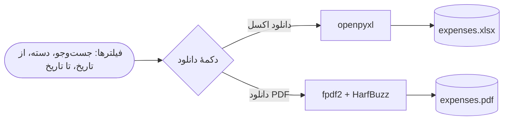
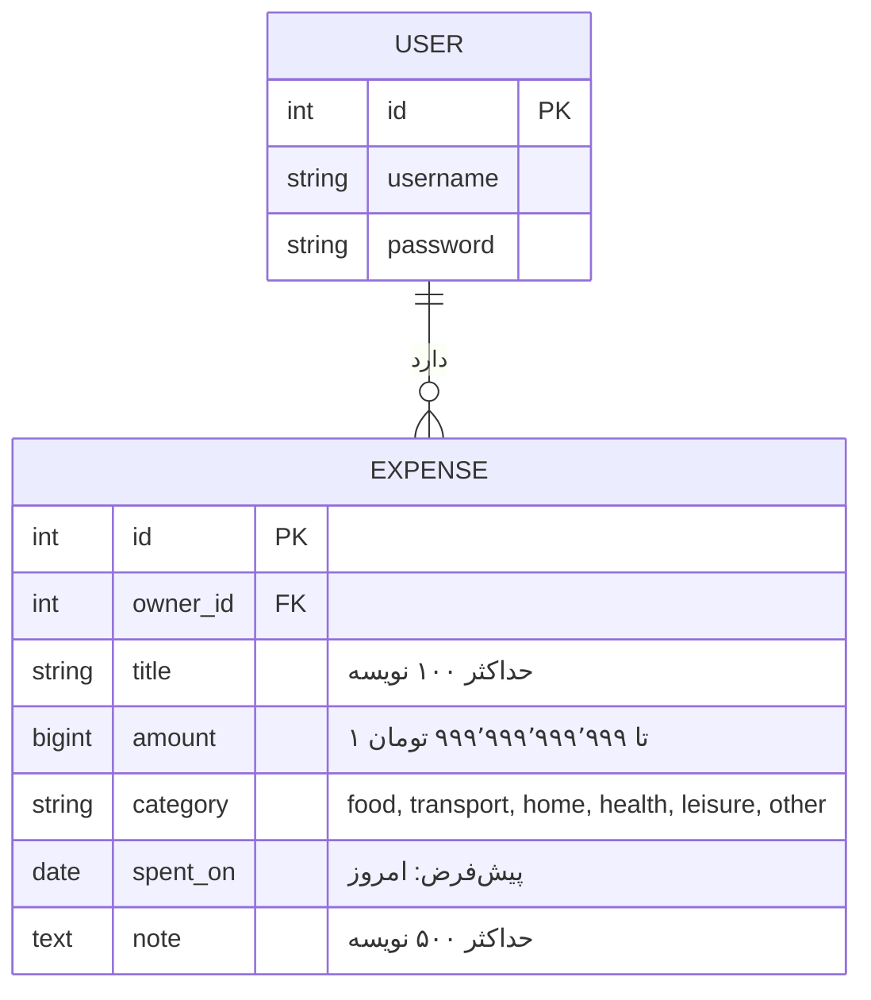

<div dir="rtl" align="center">


<br>


### هزینه‌هایتان را ثبت کنید، دسته‌بندی کنید و به‌صورت گزارش Excel یا PDF تحویل بگیرید.

[✨ امکانات](#-امکانات) &nbsp;•&nbsp;
[🚀 شروع سریع](#-شروع-سریع) &nbsp;•&nbsp;
[📊 گزارش‌گیری](#-گزارشگیری-excel-و-pdf) &nbsp;•&nbsp;
[🧱 معماری](#-معماری-و-ساختار) &nbsp;•&nbsp;
[👥 سازندگان](#-سازندگان)

</div>

<br>

<div dir="rtl">

## 🎯 دربارهٔ پروژه

**CostManagement** یک برنامهٔ وب برای مدیریت هزینه‌های شخصی است که با **Django 5.2** و پایگاه دادهٔ **SQLite** ساخته شده و رابط کاربری آن کاملاً **فارسی و راست‌چین** است. هر کاربر حساب جداگانه دارد، هزینه‌هایش را با عنوان، مبلغ، دسته، تاریخ و یادداشت ثبت می‌کند و در هر لحظه خلاصهٔ وضعیت مالی خودش را روی داشبورد می‌بیند.

بدون وابستگی به فریم‌ورک‌های سنگین فرانت‌اند؛ فقط HTML، CSS و کمی JavaScript ساده، با چیدمان جداگانه برای موبایل و پشتیبانی از **حالت روشن و تیره**.

<br>

<div align="center">

<br>
<sub>پیش‌نمایش گرافیکی داشبورد (نمونهٔ طراحی‌شده با داده‌های فرضی)</sub>
</div>

<br>

## ✨ امکانات

<table dir="rtl">
<tr>
<td width="50%" valign="top">

### 🔐 حساب کاربری امن
- ثبت‌نام، ورود، خروج و تغییر رمز عبور
- **کپچای ریاضی** یک‌بارمصرف با اعتبار ۵ دقیقه
- اعتبارسنجی استاندارد رمز عبور جنگو
- دکمهٔ نمایش/پنهان‌کردن رمز

</td>
<td width="50%" valign="top">

### 💸 مدیریت هزینه‌ها
- ثبت، ویرایش و حذف هزینه
- عنوان، مبلغ (تومان)، دسته، تاریخ و یادداشت
- ۶ دستهٔ آماده: خوراک، رفت‌وآمد، خانه، سلامت، تفریح، سایر
- جداسازی کامل داده‌های هر کاربر

</td>
</tr>
<tr>
<td width="50%" valign="top">

### 📈 داشبورد هوشمند
- هزینهٔ **ماه جاری**
- **مجموع** همهٔ هزینه‌ها
- **تعداد** هزینه‌های ثبت‌شده
- فهرست صفحه‌بندی‌شده (۱۰ ردیف در هر صفحه)

</td>
<td width="50%" valign="top">

### 🔎 جست‌وجو و فیلتر
- جست‌وجو بر اساس عنوان
- فیلتر دسته‌بندی
- بازهٔ تاریخ (از / تا)
- حفظ فیلترها هنگام جابه‌جایی بین صفحه‌ها

</td>
</tr>
<tr>
<td width="50%" valign="top">

### 📄 خروجی Excel و PDF
- گزارش RTL با فونت فارسی **Noto Sans Arabic**
- جمع مبلغ و تعداد هزینه‌ها در گزارش
- خروجی دقیقاً مطابق فیلترهای فعال

</td>
<td width="50%" valign="top">

### 🎨 تجربهٔ کاربری
- حالت **روشن / تیره** با ذخیره در مرورگر
- پیروی خودکار از تنظیمات دستگاه
- طراحی واکنش‌گرا برای گوشی
- ارقام فارسی و جداکنندهٔ هزارگان

</td>
</tr>
</table>

> [!NOTE]
> واحد مبلغ **تومان** است. تقویم ثبت هزینه، فیلتر تاریخ و محاسبهٔ «هزینهٔ ماه جاری» بر پایهٔ **تاریخ میلادی** انجام می‌شود.

<br>

## 🛠️ فناوری‌های استفاده‌شده

| لایه | فناوری | نقش در پروژه |
| :--- | :--- | :--- |
| **بک‌اند** | Django `>=5.2,<5.3` | مسیریابی، احراز هویت، ORM و پنل مدیریت |
| **پایگاه داده** | SQLite | ذخیره‌سازی سبک و بدون نیاز به راه‌اندازی جداگانه |
| **گزارش Excel** | openpyxl `>=3.1.5,<3.2` | ساخت فایل `.xlsx` راست‌چین با فیلتر و فریز سطر |
| **گزارش PDF** | fpdf2 `>=2.8.5,<2.9` + uharfbuzz | ساخت PDF فارسی با شکل‌دهی درست حروف |
| **فرانت‌اند** | HTML + CSS + JavaScript | قالب‌های جنگو، تم روشن/تیره و ظاهر واکنش‌گرا |
| **فونت‌ها** | Noto Sans / Noto Sans Arabic | نمایش درست متن فارسی در PDF |

<br>

## 🚀 شروع سریع

### پیش‌نیاز
**Python 3.10** یا بالاتر روی سیستم نصب باشد.

### ۱) آماده‌سازی محیط

فایل ZIP را استخراج کنید و ترمینال را در پوشه‌ای باز کنید که `manage.py` در آن قرار دارد.

```bash
python -m venv .venv
```

فعال‌سازی محیط مجازی:

```powershell
# Windows (PowerShell)
.\.venv\Scripts\Activate.ps1
```

```bash
# Linux / macOS
source .venv/bin/activate
```

### ۲) نصب و اجرا

```bash
python -m pip install -r requirements.txt
python manage.py migrate
python manage.py runserver
```

### ۳) ورود به برنامه

۱. آدرس <http://127.0.0.1:8000/> را باز کنید.
۲. در صفحهٔ ورود روی **«ثبت‌نام»** بزنید.
۳. در فرم‌های ثبت‌نام و ورود، **حاصل جمع کپچا** را وارد کنید. سؤال با هر تلاش عوض می‌شود و ۵ دقیقه اعتبار دارد.

> [!TIP]
> برای دسترسی به پنل مدیریت، یک ابرکاربر بسازید:
> ```bash
> python manage.py createsuperuser
> ```
> سپس به <http://127.0.0.1:8000/admin/> بروید.

<br>

## 📊 گزارش‌گیری Excel و PDF



۱. در داشبورد، فیلترهای دلخواه (جست‌وجو، دسته‌بندی، تاریخ شروع) را وارد کنید.
۲. برای گزارش تا یک روز مشخص، تاریخ میلادی را در **«تا تاریخ»** بنویسید. هزینه‌های خود همان روز هم در گزارش می‌آیند.
۳. روی **«دانلود اکسل»** یا **«دانلود PDF»** بزنید.

| ویژگی | Excel | PDF |
| :--- | :---: | :---: |
| چیدمان راست‌چین | ✅ | ✅ |
| عنوان و خلاصهٔ فیلترهای اعمال‌شده | ✅ | ✅ |
| جمع مبلغ و تعداد هزینه‌ها | ✅ | ✅ |
| فیلتر خودکار ستون‌ها و فریز سطر عنوان | ✅ | — |
| شماره‌گذاری صفحه | — | ✅ |

اگر تاریخ پایان را خالی بگذارید، گزارش محدودیت تاریخ پایان ندارد و همهٔ ردیف‌های مطابق فیلتر در آن قرار می‌گیرند. نام فایل خروجی هم به‌صورت خودکار شامل تاریخ پایان است، مثل `expenses-through-2026-11-20.pdf`.

> [!IMPORTANT]
> اگر نسخهٔ قبلی پروژه را دارید، پس از جایگزین‌کردن فایل‌ها دستور `python -m pip install -r requirements.txt` را دوباره اجرا کنید تا کتابخانه‌های گزارش نصب شوند. فایل `db.sqlite3` فعلی‌تان را در پوشهٔ پروژه نگه دارید.

<br>

## 🧱 معماری و ساختار

### مدل داده



### مسیرهای برنامه

| مسیر | نام | توضیح |
| :--- | :--- | :--- |
| `/` | `dashboard` | داشبورد، جست‌وجو، فیلتر و خروجی گزارش |
| `/login/` | `login` | ورود با کپچا |
| `/signup/` | `signup` | ثبت‌نام با کپچا |
| `/logout/` | `logout` | خروج از حساب |
| `/password/` | `password` | تغییر رمز عبور |
| `/expenses/new/` | `expense_new` | ثبت هزینهٔ جدید |
| `/expenses/<id>/edit/` | `expense_edit` | ویرایش هزینه |
| `/expenses/<id>/delete/` | `expense_delete` | حذف هزینه با تأیید |
| `/admin/` | — | پنل مدیریت جنگو |

### درخت پروژه

```text
costmanagement/
├── manage.py
├── requirements.txt
├── costmanagement/          # تنظیمات و مسیر اصلی پروژه
│   ├── settings.py
│   ├── urls.py
│   └── wsgi.py
├── expenses/                # اپلیکیشن اصلی
│   ├── models.py            # مدل هزینه و دسته‌بندی‌ها
│   ├── forms.py             # فرم‌ها، کپچا و اعتبارسنجی
│   ├── views.py             # ورود، داشبورد و عملیات هزینه
│   ├── reports.py           # ساخت گزارش Excel و PDF
│   ├── urls.py
│   ├── admin.py
│   ├── templatetags/        # فیلترهای ارقام فارسی و مبلغ
│   └── migrations/
├── templates/               # صفحه‌های HTML
└── static/
    ├── style.css            # ظاهر، تم روشن و تیره، چیدمان موبایل
    ├── theme.js             # تغییر و ذخیرهٔ تم
    ├── main.js              # دکمهٔ نمایش رمز
    └── fonts/               # فونت‌های Noto برای PDF
```

<br>

## 🔒 نکات امنیتی و تنظیمات

- هر کاربر فقط به هزینه‌های **خودش** دسترسی دارد؛ ویرایش و حذف هزینهٔ دیگران پاسخ ۴۰۴ می‌دهد.
- پاسخ کپچا **پس از هر ارسال مصرف می‌شود** و فقط ۵ دقیقه معتبر است.
- فایل‌های گزارش با هدر `Cache-Control: private, no-store` ارسال می‌شوند.
- فرم‌ها با **CSRF** محافظت می‌شوند و حذف فقط با درخواست `POST` انجام می‌شود.
- مقادیر حساس از طریق متغیرهای محیطی قابل تنظیم‌اند:

| متغیر محیطی | مقدار پیش‌فرض | کاربرد |
| :--- | :--- | :--- |
| `DJANGO_SECRET_KEY` | کلید آزمایشی محلی | کلید مخفی جنگو |
| `DJANGO_DEBUG` | `1` | حالت دیباگ (`0` برای غیرفعال‌کردن) |
| `DJANGO_ALLOWED_HOSTS` | `localhost,127.0.0.1,[::1]` | میزبان‌های مجاز، جداشده با ویرگول |

> [!WARNING]
> تنظیمات پیش‌فرض برای **اجرای محلی و آموزشی** آماده شده‌اند. پیش از هر استقرار واقعی، حتماً `DJANGO_SECRET_KEY` را عوض کنید و `DJANGO_DEBUG=0` بگذارید.

<br>

## 🗺️ ایده‌هایی برای توسعهٔ بعدی

- [ ] نمودار هزینه‌ها بر اساس دسته و ماه
- [ ] پشتیبانی از تقویم شمسی
- [ ] تعیین بودجهٔ ماهانه و هشدار عبور از آن
- [ ] دسته‌بندی‌های سفارشی
- [ ] خروجی CSV

<br>

## 👥 سازندگان

<div align="center">

<table>
<tr>
<td align="center" width="260">
<br>
<b>👩‍💻 Aria Kiani</b>
<br><sub>Developer</sub>
<br><br>
</td>
<td align="center" width="260">
<br>
<b>👨‍💻 Mohammad Arami</b>
<br><sub>Developer</sub>
<br><br>
</td>
</tr>
</table>

<sub>ساخته‌شده با ❤️ توسط **Aria Kiani** و **Mohammad Arami**</sub>

</div>

<br>

## 🙏 قدردانی

فونت‌های **Noto Sans** و **Noto Sans Arabic** برای ساخت گزارش PDF استفاده شده‌اند. مجوز آن‌ها در `static/fonts/LICENSE.txt` موجود است.

<br>

<div align="center">

**اگر این پروژه برایتان مفید بود، یک ⭐ فراموش نشود.**

<sub>CostManagement © ۲۰۲۶ — Aria Kiani & Mohammad Arami</sub>

</div>

</div>
