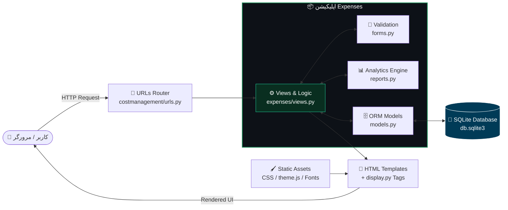

<div align="center">
  <!-- بنر گرافیکی بالای صفحه -->
  

  <br />

  <!-- بج‌های تکنولوژی‌ها -->
  <p>
    
    
    
    
    
    
  </p>

  <!-- بج‌های وضعیت و ویژگی‌ها -->
  <p>
    
    
    
    
  </p>

  <!-- منوی دسترسی سریع -->
  <h4>
    <a href="#-درباره-پروژه">📖 درباره پروژه</a> •
    <a href="#-ویژگیها-و-امکانات">✨ ویژگی‌ها</a> •
    <a href="#-معماری-سیستم">🏗️ معماری</a> •
    <a href="#-ساختار-فایلها">🗂️ ساختار</a> •
    <a href="#-راهنمای-نصب-و-اجرا-در-محیط-لوکال">🚀 نصب و اجرا</a> •
    <a href="#-توسعهدهندگان">👨‍💻 نویسندگان</a>
  </h4>
</div>

---

<div dir="rtl">

## 📖 درباره پروژه

**Cost Management** یک وب‌اپلیکیشن مدرن، سبک و کاربردی برای **مدیریت مالی شخصی، ثبت مخارج و گزارش‌گیری دقیق** است که با قدرت فریم‌ورک **Django** پیاده‌سازی شده است.

این سامانه با تمرکز بر سادگی، سرعت بالا و معماری تمیز طراحی شده است و بدون وابستگی به کتابخانه‌های سنگین فرانت‌اند، امکاناتی مانند **تغییر تم (روشن/تاریک)**، **سیستم احراز هویت اختصاصی**، **موتور تحلیل و گزارش‌گیری (`reports.py`)** و **تایپوگرافی استاندارد فارسی (`Noto Sans Arabic`)** را به صورت یکپارچه ارائه می‌دهد.

</div>

---

<div dir="rtl">

## ✨ ویژگی‌ها و امکانات

</div>

<table align="center" width="100%">
  <tr>
    <td width="50%" align="right" dir="rtl" valign="top">
      <h3>🔐 سیستم احراز هویت و امنیت</h3>
      <ul>
        <li>صفحات اختصاصی <b>ثبت‌نام (Signup)</b> و <b>ورود (Login)</b> با چیدمان مستقل (<code>auth_layout.html</code>)</li>
        <li>مدیریت کامل حساب کاربری و <b>تغییر رمز عبور</b> همراه با صفحه تایید (<code>password.html</code> و <code>password_done.html</code>)</li>
        <li>جداسازی کامل اطلاعات مالی هر کاربر در پایگاه داده</li>
      </ul>
    </td>
    <td width="50%" align="right" dir="rtl" valign="top">
      <h3>💸 مدیریت جامع هزینه‌ها (CRUD)</h3>
      <ul>
        <li>ثبت سریع و ویرایش تراکنش‌ها با فرم‌های اعتبارسنجی‌شده (<code>forms.py</code> و <code>expense_form.html</code>)</li>
        <li>حذف ایمن هزینه‌ها همراه با صفحه هشدار و تایید نهایی (<code>expense_delete.html</code>)</li>
        <li>نمایش پویای پیام‌های خطا و موفقیت به کاربر (<code>messages.html</code>)</li>
      </ul>
    </td>
  </tr>
  <tr>
    <td width="50%" align="right" dir="rtl" valign="top">
      <h3>📊 داشبورد و گزارش‌گیری هوشمند</h3>
      <ul>
        <li>داشبورد جامع برای مشاهده خلاصه وضعیت مالی در یک نگاه (<code>dashboard.html</code>)</li>
        <li>ماژول اختصاصی پردازش آمار و تولید گزارش‌های مالی در <code>reports.py</code></li>
        <li>استفاده از <b>Template Tags</b> سفارشی (<code>display.py</code>) برای قالب‌بندی دقیق مبالغ و اعداد</li>
      </ul>
    </td>
    <td width="50%" align="right" dir="rtl" valign="top">
      <h3>🎨 رابط کاربری مدرن و Dark Mode</h3>
      <ul>
        <li>پشتیبانی کامل از <b>حالت تاریک و روشن</b> با دکمه اختصاصی و ذخیره‌سازی انتخاب کاربر (<code>theme.js</code>)</li>
        <li>استفاده از فونت‌های استاندارد <b>Noto Sans</b> و <b>Noto Sans Arabic</b> برای خوانایی حداکثری</li>
        <li>قالب‌بندی کاملاً ماژولار در HTML (<code>base.html</code>, <code>field.html</code>, <code>account_fields.html</code>)</li>
      </ul>
    </td>
  </tr>
</table>

---

<div dir="rtl">

## 🏗️ معماری سیستم

پروژه بر پایه الگوی معماری **MVT (Model-View-Template)** جنگو توسعه داده شده است. نمودار زیر جریان درخواست‌ها و ارتباط بین اجزای اصلی سامانه را نشان می‌دهد:

</div>



---

<div dir="rtl">

## 🗂️ ساختار فایل‌ها

</div>

```text
costmanagement/
│
├── 📂 costmanagement/             # تنظیمات هسته اصلی پروژه جنگو
│   ├── settings.py                # پیکربندی دیتابیس، استاتیک‌ها، قالب‌ها و امنیت
│   ├── urls.py                    # مسیریابی اصلی (Root URL Configuration)
│   └── wsgi.py                    # نقطه ورود سرور برای استقرار (Deployment)
│
├── 📂 expenses/                   # اپلیکیشن اصلی مدیریت هزینه‌ها و گزارش‌ها
│   ├── 📂 migrations/             # تاریخچه تغییرات دیتابیس (0001_initial.py)
│   ├── 📂 templatetags/           # تگ‌ها و فیلترهای اختصاصی قالب‌ها
│   │   └── display.py             # فرمت‌دهی هوشمند نمایش مبالغ در HTML
│   ├── admin.py                   # ثبت مدل‌ها در پنل مدیریت ادمین جنگو
│   ├── forms.py                   # فرم‌های ثبت هزینه و مدیریت حساب کاربری
│   ├── models.py                  # ساختار جداول پایگاه داده
│   ├── reports.py                 # موتور محاسبات مالی و خروجی گزارش‌ها
│   ├── urls.py                    # مسیرهای داخلی اپلیکیشن expenses
│   └── views.py                   # کنترلرها و منطق پردازش صفحات
│
├── 📂 static/                     # دارایی‌های استاتیک فرانت‌اند
│   ├── 📂 fonts/                  # خانواده فونت NotoSans & NotoSansArabic + License
│   ├── style.css                  # استایل‌های اصلی، ریسپانسیو و متغیرهای تم
│   ├── theme.js                   # اسکریپت مدیریت و ذخیره تم روشن/تاریک
│   └── main.js                    # تعاملات جاوااسکریپت رابط کاربری
│
├── 📂 templates/                  # قالب‌های ماژولار HTML
│   ├── base.html                  # اسکلت اصلی تمام صفحات سایت
│   ├── auth_layout.html           # چیدمان اختصاصی صفحات احراز هویت
│   ├── dashboard.html             # داشبورد اصلی کاربر
│   ├── expense_form.html          # فرم ایجاد و ویرایش هزینه
│   ├── expense_delete.html        # صفحه تایید حذف تراکنش
│   ├── login.html & signup.html   # صفحات ورود و ثبت‌نام
│   ├── password.html              # فرم تغییر رمز عبور
│   ├── password_done.html         # صفحه تایید تغییر موفق رمز عبور
│   └── ...                        # کامپوننت‌ها (messages, field, theme_button, account_fields)
│
├── 🗄️ db.sqlite3                  # پایگاه داده پیش‌فرض پروژه
├── ⚙️ manage.py                   # ابزار خط فرمان مدیریت و اجرای پروژه
├── 📋 requirements.txt            # لیست وابستگی‌ها و پکیج‌های پایتون
└── 📄 README.md                   # مستندات پروژه
```

---

<div dir="rtl">

## 🚀 راهنمای نصب و اجرا در محیط لوکال

برای اجرای این پروژه روی سیستم شخصی خود، مراحل زیر را به ترتیب در ترمینال اجرا کنید:

### ۱. پیش‌نیازها
* **Python 3.10+** (نسخه پیشنهادی: `Python 3.12`)
* مدیر بسته **pip** و ابزار **Git**

### ۲. دریافت پروژه و ساخت محیط مجازی

</div>

```bash
# ۱. کلون کردن مخزن از گیت‌هاب
git clone https://github.com/YOUR_USERNAME/costmanagement.git
cd costmanagement

# ۲. ایجاد محیط مجازی (Virtual Environment)
python -m venv venv
```

<details>
<summary><b>🖥️ نحوه فعال‌سازی محیط مجازی در سیستم‌عامل‌های مختلف (کلیک کنید)</b></summary>

* **ویندوز (CMD / PowerShell):**
  ```bash
  venv\Scripts\activate
  ```
* **مک و لینوکس (macOS / Linux):**
  ```bash
  source venv/bin/activate
  ```
</details>

<div dir="rtl">

### ۳. نصب پکیج‌ها و اجرای سرور

</div>

```bash
# ۳. نصب تمام پیش‌نیازهای پروژه
pip install -r requirements.txt

# ۴. اعمال مایگریشن‌های دیتابیس (برای اطمینان از به‌روز بودن جداول)
python manage.py migrate

# ۵. اجرای سرور توسعه جنگو
python manage.py runserver
```

<div dir="rtl">

🎉 **پروژه آماده است!** اکنون مرورگر خود را باز کنید و وارد آدرس زیر شوید:
👉 **[http://127.0.0.1:8000/](http://127.0.0.1:8000/)**

</div>

<details>
<summary><b>🔑 ساخت حساب مدیر (Superuser) برای ورود به پنل ادمین جنگو (اختیاری)</b></summary>

```bash
python manage.py createsuperuser
```
پس از وارد کردن نام کاربری و رمز عبور، می‌توانید از طریق آدرس `http://127.0.0.1:8000/admin/` وارد پنل مدیریت شوید.

</details>

---

<div dir="rtl">

## 📸 پیش‌نمایش رابط کاربری

> 💡 *نکته: پس از اجرای پروژه روی سیستم خود، از محیط داشبورد در دو حالت **روشن** و **تاریک** اسکرین‌شات بگیرید، آن‌ها را در پوشه‌ای به نام `screenshots` در مخزن گیت‌هاب آپلود کنید و لینک‌های زیر را جایگزین نمایید.*

</div>

<table align="center" width="100%">
  <tr>
    <th align="center" width="50%">☀️ حالت روشن (Light Mode)</th>
    <th align="center" width="50%">🌙 حالت تاریک (Dark Mode)</th>
  </tr>
  <tr>
    <td align="center">
      
    </td>
    <td align="center">
      
    </td>
  </tr>
</table>

---

<div dir="rtl">

## 👨‍💻 توسعه‌دهندگان

این پروژه با دقت و اشتیاق توسط تیم زیر طراحی و پیاده‌سازی شده است:

</div>

<table align="center" width="100%">
  <tr>
    <td align="center" width="50%">
      <br />
      <h3>🚀 Aria Kiani</h3>
      <p><b>آریا کیانی</b></p>
      <p><i>Co-Author & Full-Stack Developer</i></p>
      <p>
        <a href="https://github.com/">
          
        </a>
        <a href="https://linkedin.com/">
          
        </a>
      </p>
    </td>
    <td align="center" width="50%">
      <br />
      <h3>⚡ Mohammad Arami</h3>
      <p><b>محمد آرامی</b></p>
      <p><i>Co-Author & Full-Stack Developer</i></p>
      <p>
        <a href="https://github.com/">
          
        </a>
        <a href="https://linkedin.com/">
          
        </a>
      </p>
    </td>
  </tr>
</table>

---

<div dir="rtl">

## 🤝 مشارکت و مجوز انتشار

* مشارکت در بهبود این پروژه، گزارش باگ‌ها (Issues) و ارسال **Pull Request** همیشه مورد استقبال است.
* این پروژه تحت مجوز **MIT License** منتشر شده است. همچنین فونت‌های موجود در مسیر `static/fonts/` تحت مجوز **SIL Open Font License (OFL)** قرار دارند.

</div>

<div align="center">
  <br />
  <p><b>اگر این پروژه برای شما مفید بود، لطفاً با دادن یک ستاره ⭐ از ما حمایت کنید!</b></p>
  <!-- فوتر گرافیکی پایین صفحه -->
  
</div>